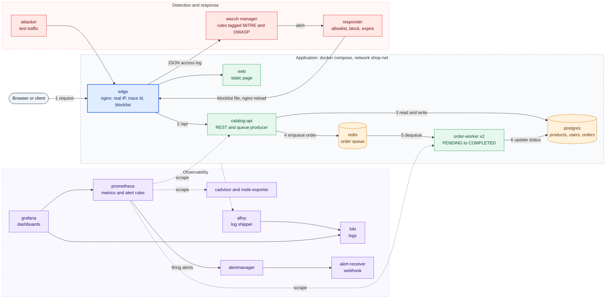
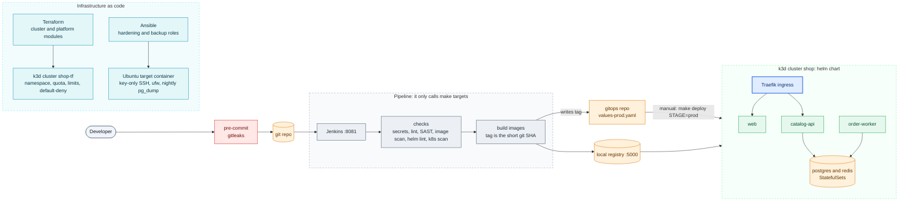

# Architecture

Colours: blue is the public entry, green is application services, orange is data, purple is observability, red is security, grey is delivery tooling.

## Runtime view

## Delivery and infrastructure

